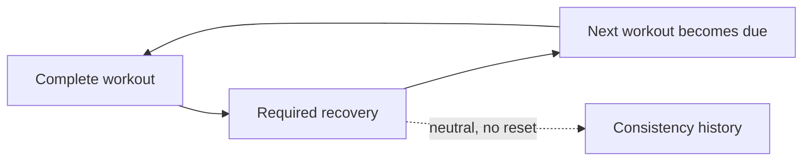

<p align="center">
  
</p>

<h1 align="center">Momentum</h1>

<p align="center">A private, native iPhone routine for training, nutrition, hydration, and personal care.</p>

I built Momentum for my own daily habits. I wanted one calm place to move through workouts, food, hydration, and personal care, but I could not find a free iOS option that fit the way I wanted to run a personal routine. So I made the tool I wanted to use: focused on the next useful action, honest about missed days, and private by default.

## Why Momentum

Momentum turns the next useful action into a small, clear sequence. Open **Today** to see what is due, log it quickly, and let the app preserve the right context when plans or dates change.

It is built around a continuous, recovery-driven workout cycle—not a calendar that resets every Monday.

- Finish a workout to advance to the next workout.
- Recovery days create no workout obligation and do not break consistency.
- Missed or skipped opportunities stay honest without creating catch-up workouts.
- The Domain Day cutoff (03:00 by default) can be adjusted from Settings, so late-night activity is attributed to the day that makes sense for you.



## What it includes

| Module | Use it for |
| --- | --- |
| **Workout** | Build, edit, and reorder a continuous cycle (the example plan is Upper A → Lower A → Upper B → Lower B), with exercise sessions, working sets, history, and recovery-aware scheduling |
| **Nutrition** | Manual food entries, calories, protein, editable targets, and explicit day finalization |
| **Hydration** | Daily fluid target, quick presets or custom amounts, and intake history |
| **Personal care** | Morning/night skincare, interval-based hair care, and post-workout care when applicable |
| **Shared views** | Today, History, Plans, Progress, reminders, consistency, and correction tools |

Momentum starts empty by default apart from the settings needed to launch. Onboarding can optionally establish a starting plan, targets, and reminders.

### A normal day

Today brings the active thread together: start or resume the next workout, add food or water, complete due care routines, and glance at consistency. History keeps corrections tied to the day they belong to. Plans changes future behavior while preserving snapshots of completed work, so an edit does not rewrite the past.

The app stays deliberately practical: native SwiftUI navigation, short logging flows, reminders you can adjust, and factual status language instead of streak pressure or health claims.

## Privacy and storage

Momentum is designed for one person and has no app account, ads, analytics, social layer, or custom backend. Data is stored locally with SwiftData, so the app remains usable offline. The production model is configured for the Routine Owner’s private CloudKit database; the container is `iCloud.com.pratham.momentum`.

CloudKit integration is configured in the project, but production sync and device recovery still require verification with your own Apple Developer team and container configuration. Simulator runs automatically use a disk-backed local-only store. The `-usePreviewStore` launch argument uses an ephemeral in-memory store and is intended for previews/tests.

You can prepare UTF-8 CSV exports from Settings, including workouts, food, hydration, measurements, care, and adherence data for enabled modules, with stable IDs, timestamps, Domain Days, and historical snapshot values.

## Build and run

### Requirements

- Xcode 26 (the repository was validated with Xcode 26.4)
- Swift 6.2 toolchain
- iOS 26 or later
- An iPhone simulator or device; device signing and CloudKit container identifiers must use your own Apple Developer team

The committed `Momentum.xcodeproj` is the normal entry point. XcodeGen is optional and is only needed if you change `project.yml` and want to regenerate the project.

### Simulator

1. Clone the repository:

   ```bash
   git clone https://github.com/prathams96/momentum.git
   cd momentum
   ```

2. Open `Momentum.xcodeproj` in Xcode.
3. Select the **Momentum** scheme and an iPhone running iOS 26+.
4. Build and run.

For a signing-free simulator build from Terminal:

```bash
xcodebuild -project Momentum.xcodeproj -scheme Momentum \
  -destination 'generic/platform=iOS Simulator' \
  CODE_SIGNING_ALLOWED=NO build
```

### Tests

Run the app’s unit and UI tests with **Product → Test** (⌘U) on the **Momentum** scheme, or use a simulator installed on your machine:

```bash
xcodebuild -project Momentum.xcodeproj -scheme Momentum \
  -destination 'platform=iOS Simulator,name=iPhone 17 Pro' \
  CODE_SIGNING_ALLOWED=NO test
```

Substitute another installed iOS 26 simulator when needed. Run validation on an iOS simulator using the Momentum scheme.

## Repository map

```text
Momentum/                  iPhone app: SwiftUI features, modules, persistence, exports
Sources/MomentumCore/      Shared domain engines and pure logic
Tests/MomentumCoreTests/   Core behavior tests
MomentumTests/             App unit tests
MomentumUITests/           UI smoke and interaction tests
Momentum.xcodeproj/        Committed Xcode project
project.yml                Optional XcodeGen project source
```

Useful design and architecture references:

- [`CONTEXT.md`](CONTEXT.md) — domain glossary and naming guide
- [`docs/CURRENT-PRODUCT-SPEC.md`](docs/CURRENT-PRODUCT-SPEC.md) — implemented product baseline
- [`docs/PRODUCT-SPEC.md`](docs/PRODUCT-SPEC.md) — intended product behavior
- [`docs/TECHNICAL-SPEC.md`](docs/TECHNICAL-SPEC.md) — platform and technical constraints
- [`CURRENT-ARCHITECTURE-MAP.md`](CURRENT-ARCHITECTURE-MAP.md) — current code ownership and dependency map
- [`docs/adr/0001-use-a-continuous-recovery-driven-workout-cycle.md`](docs/adr/0001-use-a-continuous-recovery-driven-workout-cycle.md) — workout scheduling decision
- [`docs/adr/0002-use-swiftdata-with-private-cloudkit-sync.md`](docs/adr/0002-use-swiftdata-with-private-cloudkit-sync.md) — persistence and sync decision

## Contributing

Momentum is an evolving personal project. If you find a bug or have a focused improvement, open an issue with reproduction details. For code changes, open a pull request that explains the behavior changed and includes the relevant simulator test result. Please keep changes aligned with the native iOS, privacy-first, recovery-driven product direction.
