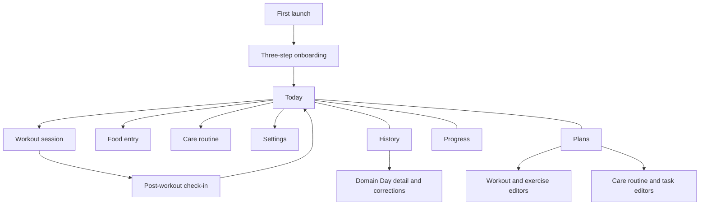
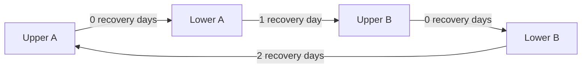

# Momentum — Current Product Specification

**Document type:** implemented-product baseline for future planning  
**Implementation reviewed:** 5 August 2026  
**Platform:** native iPhone app, iOS 26+  
**Build observed:** iPhone 17 Pro Max Simulator, iOS 26.4, local preview store  
**Related documents:** [product intent](../PRODUCT.md), [normative feature specification](./PRODUCT-SPEC.md), [technical specification](./TECHNICAL-SPEC.md), [design system](../DESIGN.md), and [implementation gaps](./IMPLEMENTATION-GAPS.md)

## 1. Purpose and reading guide

This document describes the product that exists in the repository today. It is intended to be the planning baseline for future updates: what users can currently do, the rules behind those actions, the major user flows, persisted data, edge cases, and the release work that remains.

The older `PRODUCT-SPEC.md` remains the normative source for intended behavior. This document adds an implementation-oriented view and explicitly separates:

- **Implemented:** connected to persisted data and available in the current UI.
- **Implemented with release validation remaining:** code exists, but device, CloudKit, accessibility, or production evidence is incomplete.
- **Not currently included:** a deliberate non-goal or future opportunity.

The screenshots use the seeded local preview store. They show real SwiftUI screens from the running app, not design mockups. The data is intentionally sparse so that empty and first-use behavior is visible.

## 2. Product summary

Momentum is a private, personal execution system for one Routine Owner. It combines four daily systems in one native iPhone app:

1. A continuous Upper/Lower workout cycle driven by actual completion and recovery.
2. Manual calorie and protein logging.
3. Calendar-based morning and night skincare routines.
4. Alternating-interval hair care, plus conditional post-workout care.

The central product promise is that the user can open Today, immediately understand the next useful action, log it with little ceremony, and trust the app to preserve historical truth when plans or past entries change.

### Primary user

The current product is designed for one person using the app in short bursts:

- between sets at the gym;
- around meals;
- during morning and evening care;
- during occasional review or plan-editing sessions.

There is no account creation, multi-user mode, coach view, social layer, or public profile.

### Product principles visible in the implementation

- **Today before totals.** The default screen prioritizes what is due now.
- **Sequence before weekdays.** Workouts follow the continuous cycle and recovery, not a weekly reset.
- **Fast input, durable history.** Common inputs are quick, while completed activities preserve snapshots.
- **Accountability without shame.** Missed and skipped states are factual; recovery is neutral.
- **Native restraint.** The product uses SwiftUI navigation, sheets, forms, tab bars, charts, and system controls.

## 3. Information architecture

After onboarding, the app has four persistent tabs. Settings is reached from Today.

| Area | Primary purpose | Main actions |
|---|---|---|
| **Today** | Execute the current Domain Day | Start/resume a workout, log food, finalize nutrition, complete care, inspect consistency |
| **History** | Review and correct past facts | Filter the heatmap, open a day, edit/move/delete facts, undo supported corrections |
| **Plans** | Change future configuration | Reorder the workout cycle, edit workouts/exercises, set nutrition targets, edit care schedules/tasks |
| **Progress** | Understand longer-term trends | Log measurements, inspect charts, review exercise performance, manage load suggestions and milestones |
| **Settings** | Configure the app and manage data | Units, appearance, Domain Day cutoff, reminders, CSV export, reset, system status |

## 4. Shared domain rules

These rules affect multiple screens and should be treated as foundational when planning changes.

### 4.1 Domain Day

A Domain Day is the app-wide day boundary for workouts, nutrition, care, measurements, adherence, and history.

- Default cutoff: **03:00 local time**.
- Activity before the cutoff belongs to the previous civil date.
- The cutoff is editable from 00:00 through 12:00 in 30-minute steps.
- Changing the cutoff requires confirmation and explains whether the current moment changes attribution.
- Calendar arithmetic is used instead of fixed 24-hour durations, preserving daylight-saving correctness.

### 4.2 Historical snapshots

Plan edits are future-facing. Historical records retain the context in which they were created:

- a workout session snapshots its workout name, focus, exercise order, set count, rep range, notes, selected alternative, and schedule context;
- a food entry snapshots its name, base calories, base protein, multiplier, and calculated totals;
- a completed nutrition day snapshots the target active on that Domain Day;
- a care occurrence and its tasks retain routine/task copy;
- measurements retain their metric value and source even when the display unit changes.

### 4.3 Reconciliation

The app runs a central reconciliation pass after onboarding, app activation, meaningful mutations, historical corrections, plan/settings changes, and relevant time changes. Reconciliation:

- creates due care occurrences;
- marks or rolls missed care as appropriate;
- records elapsed missed workout opportunities;
- repairs supported duplicates;
- recalculates schedule and adherence facts;
- cancels stale reminders and schedules the next valid reminders.

### 4.4 Adherence

Daily adherence is derived rather than stored as authoritative data.

`score = completed due activities / total due activities × 100`

- Each due activity has equal weight.
- Recovery creates no workout obligation and does not break a workout streak.
- Missed or skipped workout opportunities are incomplete.
- Nutrition adherence requires explicit finalization.
- Care adherence requires all care routines due that day to be complete.
- A day with no due activity is “no obligation,” not 0%.

## 5. Onboarding flow

Onboarding is a three-step setup shown only until `onboardingCompleted` is saved.

| Welcome | Cycle preview and choice | Starting points |
|---|---|---|
|  |  |  |

### Implemented sequence

1. **Welcome and positioning**
   - Explains the combined workout, food, and care purpose.
   - States that the workout follows recovery rather than weekdays.
   - States that the routine begins privately on the device without an account.

2. **Workout and care preview**
   - Displays the seeded Upper A, Lower A, Upper B, Lower B cycle.
   - Lets the user choose which workout is next; Upper A is preselected.
   - Previews morning, night, and hair-care systems.

3. **Starting configuration**
   - Chooses whether the selected workout is due today or tomorrow.
   - Edits calorie display target, calorie range, and protein minimum.
   - Edits morning, night, and hair-care reminder times.
   - Explains local notifications before permission is requested.
   - Displays the iCloud availability state and permits local-only use.

4. **Completion**
   - Persists settings, initial cycle anchor, and target values.
   - Requests notification permission in context when appropriate.
   - Runs reconciliation and enters Today.

### Validation and failure behavior

- Nutrition values are validated before completion.
- The display target must fall within the calorie range.
- Invalid fields remain on screen with factual messages.
- A setup save failure preserves the draft and offers retry.
- Notification unavailability does not block setup.
- iCloud unavailability does not block local use.

## 6. Today: daily execution hub

Today is the default and most important screen. Its content order is:

1. Date and “Daily thread” focus.
2. Next workout or recovery state.
3. Nutrition status and food log.
4. Due care routines.
5. Sixteen-week consistency heatmap and category streaks.

### 6.1 Daily thread

The header shows Workout, Food, Care, and Reflect as a calm sequence. The highlighted stage is derived from current state:

- active workout, due workout, or schedule repair → **Workout**;
- recovery with nutrition still open → **Food**;
- recovery with nutrition finalized and care pending → **Care**;
- recovery with food and care handled → **Reflect**.

This is directional UI only; it does not block the user from logging another category.

### 6.2 Workout card states

| State | What the user sees | Available action |
|---|---|---|
| **Due today** | Workout name, focus, exercise count | Start workout |
| **Overdue** | Original due date and same next workout | Start workout |
| **Recovery** | Days remaining and next eligible date | Start early after confirmation |
| **Active** | Unfinished workout notice | Resume workout |
| **Missing next workout** | Repair guidance | Open Plans and choose next |
| **Duplicate active sessions** | Every unfinished session with start time | Choose one to keep; other open sessions are soft-deleted without merging logs |
| **Invalid cycle** | Repair explanation | Fix the plan before normal scheduling resumes |

Starting early is allowed but never silent. The confirmation states how much recovery remains; subsequent recovery is anchored to the actual completion Domain Day.

### 6.3 Nutrition card

The Today nutrition section displays:

- consumed calories against an inclusive target range;
- consumed protein against a minimum;
- a descriptive “inside targets” or “keep logging” state;
- all nondeleted food entries for the current Domain Day;
- the current finalized/open state.

Implemented actions:

- log a new food;
- edit an existing food;
- duplicate a food entry;
- soft-delete a food entry;
- finish logging today;
- reopen a finalized nutrition day.

Finalization is an explicit adherence fact. Editing food afterward remains possible; totals, charts, and adherence are recalculated.

### 6.4 Care list

Today shows the current morning routine, current weekday’s night routine, hair care when due, and any generated post-workout care. Each row displays Due, Completed, Skipped, or Missed status and opens the routine sheet when an occurrence exists.

### 6.5 Consistency

The bottom section contains:

- a real 7-row by 16-week heatmap;
- distinct visual treatment for no obligation versus incomplete;
- workout, nutrition, and care streak summaries;
- VoiceOver labels containing date, score, completed count, and due count.

## 7. Workout scheduling and session flow

### 7.1 Continuous cycle

The default cycle is:

The next eligible Domain Day is:

`actual completion Domain Day + recovery days + 1`

Missed and skipped opportunities never advance the cycle. A long gap leaves the same workout due; the app never queues catch-up workouts or recommends doubling up.

#### Seeded workout content

| Workout | Seeded exercises |
|---|---|
| **Upper A** | Incline Dumbbell Press — 3 × 6–10; Cable Row — 3 × 8–12; Assisted Pull-Up — 2 × 6–10; Dumbbell Shoulder Press — 2 × 6–10; Cable Lateral Raise — 2 × 12–20; Cable Overhead Triceps Extension — 2 × 10–15; Face-Away Cable Curl — 2 × 10–15 |
| **Lower A** | Leg Press — 3 × 8–12; Dumbbell Goblet Squat — 3 × 8–12; Leg Extension — 2 × 10–15; Seated or Lying Leg Curl — 3 × 8–15; Machine or Leg-Press Calf Raise — 3 × 10–20; Pallof Press or Dead Bug — 3 × 8–15 |
| **Upper B** | Single-Arm Cable Lat Pulldown — 3 × 8–12; Dips or Push-Ups — 3 × 6–12; Cable Row or Cable Archer Pull — 3 × 8–15; Machine Pec Fly — 2 × 10–15; Reverse Cable Fly or Reverse Pec Deck — 2 × 12–20; Cable Triceps Pushdown — 2 × 10–15; Sideways Hammer Curl — 2 × 8–15; two optional wrist-curl finishers — 2 × 12–20 each |
| **Lower B** | Bulgarian Split Squat or Reverse Lunge — 3 × 8–12; Hip-Thrust Machine or Glute Bridge — 3 × 8–15; Leg Curl — 3 × 8–15; Leg Extension or Leg Press — 2 × 10–15; Calf Raise — 3 × 10–20; Side Plank or Pallof Press — 3 × 20–45 seconds/reps according to the chosen movement |

Configured alternatives include Cable Archer Pull, Lat Pulldown, Dead Bug, Push-Ups, Reverse Pec Deck, Reverse Lunge, Glute Bridge, and Pallof Press. The seed load increment is 1 kg for each exercise and remains editable.

### 7.2 Starting a workout

1. User taps Start workout, Resume workout, Start early, or a notification action.
2. The app creates one active Workout Session from current plan snapshots.
3. The session opens as a full-screen flow.
4. Closing the screen saves the current draft and leaves the session active.
5. Today changes to Resume workout until the session is completed.

### 7.3 Logging a session

For every working set, the current implementation supports:

- weight in kilograms or pounds, based on Settings;
- repetitions or the snapshotted repetition unit;
- reps in reserve (RIR);
- Completed, Skipped, or Pending status;
- an optional set note;
- a one-tap copy of the corresponding completed set from the previous valid session.

At exercise level, the user can:

- select a configured alternative without changing historical plans;
- skip the exercise, which skips its remaining pending sets;
- read the snapshotted prescription and notes.

The session also supports an optional workout note. Warm-up sets are deliberately not tracked.

### 7.4 Finishing a workout

- Finish Workout always records the session as completed and advances the cycle.
- If pending sets remain, the app asks: “Some sets are unfinished. Finish this workout anyway?”
- Confirming converts remaining pending sets to skipped.
- An exercise is completed only when all its sets are completed; otherwise it is skipped.
- Schedule, adherence, milestones, load suggestions, and reminders are reconciled after completion.

### 7.5 Progression suggestions

A load suggestion is generated only when a nonoptional exercise has exactly the prescribed working-set count, every set is completed, and every set reaches the snapshotted top of the rep range.

- Suggested weight = highest completed weight + configured increment.
- Suggestions are never applied automatically.
- In Progress, the user can Use, Edit, or Dismiss a suggestion.
- Accepting updates the future prescription’s working weight; history is unchanged.

### 7.6 Post-workout check-in

After completion, a sheet supports:

- optional body weight;
- optional note;
- “Heavy sweating?”;
- conditional “Going outdoors again?”.

Heavy sweating generates a post-workout Wash Face task. Going outdoors again also adds Reapply Sunscreen. The occurrence is idempotent for that workout session.

## 8. Nutrition flow

### 8.1 Log or edit food

1. Open Log Food from Today or Edit Food from Today/History.
2. Optionally choose one of up to eight recent/favorite presets.
3. Enter name, calories per serving, protein per serving, and serving multiplier.
4. Optionally save the preset as a favorite.
5. Review calculated entry totals when all fields are valid.
6. Save; Today totals and reminders reconcile.

### Field rules

| Field | Rule |
|---|---|
| Name | Required after trimming whitespace |
| Calories per serving | Required, nonnegative whole number |
| Protein per serving | Required, nonnegative decimal |
| Serving multiplier | Required, greater than zero; defaults to 1 |
| Favorite | Optional; updates the reusable preset |

Saved totals equal base values multiplied by the serving multiplier. Existing presets match names case-insensitively and are updated with the latest base values.

### 8.2 Reuse and management

- Favorites sort before other presets.
- Remaining presets sort by last use.
- Selecting a preset fills editable values rather than immediately saving.
- Today exposes Edit, Duplicate, and Delete actions.
- History adds Move to another day.
- Deletes are soft deletes and can be undone from the current History correction context.

### 8.3 Target planning

The seed target is:

- 2,400 kcal display target;
- 2,300–2,500 kcal green range;
- 150 g protein minimum.

Changing targets in Plans creates a new effective-dated target starting on the current Domain Day. Prior finalized days retain historical target snapshots.

## 9. Care flow

### 9.1 Complete a routine

1. Open a due routine from Today.
2. Tap each required task.
3. Where tasks form a conditional group, select exactly one valid variant; selecting one marks the alternatives skipped.
4. Complete Routine becomes available only when all required tasks and all conditional groups are satisfied.
5. Complete, skip, or later undo the occurrence.

Waiting periods are written instructions only. No skincare or hair-care timer exists.

### 9.2 Status and recurrence behavior

- **Pending:** tasks can be changed; routine can be skipped.
- **Completed:** task completion and timestamp are persisted; the user can undo.
- **Skipped:** explicitly recorded for that Domain Day.
- **Missed:** created by reconciliation for elapsed nonrolling care.
- **Rolled forward:** supported for hair care; the sheet shows the source day.

Completing alternating hair care advances the next due day from the actual completion Domain Day. Undo restores the prior recurrence payload.

### 9.3 Seeded care plan

| Routine | Recurrence | Default time | Tasks |
|---|---|---:|---|
| Morning care | Daily | 09:00 | Choose oily or normal/dry cleanse path; moisturizer; SPF 50 sunscreen |
| Night care — adapalene | Monday, Thursday | 22:00 | Cleanse; pat dry/wait; adapalene 0.1%; moisturizer |
| Night care — azelaic acid | Wednesday, Saturday | 22:00 | Cleanse; azelaic acid; moisturizer |
| Night care | Tuesday, Friday, Sunday | 22:00 | Cleanse; moisturizer |
| Hair care | Alternating 3/4-day interval | 08:00 when due | Wash scalp; condition hair lengths |
| Post-workout care | Generated conditionally | Immediate/current day | Wash Face; optionally Reapply Sunscreen |

Seed content uses generic roles and active ingredients. Product brands are not included, and adapalene frequency never increases automatically.

## 10. History and correction flow

### 10.1 Browse history

History provides:

- category filter: All, Workouts, Nutrition, Care, or Measurements;
- 16-week heatmap windows with Older/Newer navigation;
- category streak summaries;
- a reverse-chronological list of Domain Days that contain relevant facts;
- a day detail containing sections for workout, nutrition, care, and measurements.

### 10.2 Day detail contents

| Category | Visible facts |
|---|---|
| Workout | Completed or active sessions, finish time, note, missed/skipped opportunity events |
| Nutrition | Finalized/open state, totals, historical target snapshot, food entries and timestamps |
| Care | Due routines, post-workout identity, completion state |
| Measurements | Weight/waist value, manual or post-workout source |

### 10.3 Corrections implemented

- Edit a food entry.
- Move a food entry to another Domain Day.
- Soft-delete a food entry.
- Move a measurement to another Domain Day.
- Soft-delete a measurement.
- Edit/backdate a completed workout’s timestamp.
- Soft-delete a completed workout.
- Finalize or reopen a historical Nutrition Day.
- Undo a completed care routine, including alternating-recurrence rollback.
- Undo the most recent supported deletion while the History toolbar action remains available.

Workout timestamp edits and deletions show a nonmutating before/after schedule preview before confirmation. Logged sets remain unchanged when only completion time moves. Accepted corrections reconcile the workout cycle, adherence, milestones, and reminders.

## 11. Plans flow

### 11.1 Workout cycle

The workout list displays the current order, focus, exercise count, recovery days, and which workout is Next.

Implemented changes:

- enter Edit mode and drag to reorder the continuous cycle;
- swipe a workout to make it the next anchor;
- edit workout focus and recovery days;
- add, edit, reorder, and archive exercises;
- configure set count, rep range, rep unit, notes, load increment, optional status, and alternatives;
- use metric or imperial display/input while storing weight values in kilograms.

Plans validate a contiguous active cycle and preserve prior Workout Session snapshots.

### 11.2 Nutrition target

Steppers edit:

- display calories;
- minimum calories;
- maximum calories;
- minimum protein.

Save Target from Today begins a new effective-dated interval. The save action is disabled when the display target falls outside the calorie range.

### 11.3 Care plan

For each active care routine, the user can edit:

- name;
- recurrence type and payload;
- weekdays or alternating anchor/cadence;
- reminder time;
- roll-forward behavior;
- task order;
- task label, generic role, active ingredient, instruction, requirement type, and condition group;
- task archive state.

Logged occurrences retain their snapshots.

## 12. Progress flow

Progress is one vertically scrolling screen with the following sections.

### 12.1 Measurements

- Log and edit body weight and waist circumference.
- Display values in the selected unit system while persisting metric values.
- Plot raw weight observations and a seven-calendar-day average.
- Average multiple readings on the same day before calculating the rolling average.
- Require at least two distinct days before presenting the average.
- Plot waist observations.
- Show a non-notifying “Waist measurement is due” indicator after seven days without a waist record.
- List the eight most recent measurement records for editing.

### 12.2 Nutrition trends

- Daily calorie bars with historical minimum/maximum target lines.
- Daily protein bars with the historical minimum line.
- Textual summaries for accessibility and sparse-data states.

### 12.3 Exercise performance

- Explicit exercise picker.
- Highest completed weight and best repetitions at that weight.
- Total completed working-set volume over time.
- Disclosure list of best repetitions at every completed weight.
- No estimated one-repetition maximum.

### 12.4 Adherence

- Current workout, nutrition, and care streaks.
- Daily adherence percentage chart.
- Recovery remains neutral.

### 12.5 Suggestions and milestones

- Pending load suggestions support Use, Edit, and Dismiss.
- One unacknowledged milestone is presented at a time and remains acknowledged after dismissal.
- Implemented milestone families include 10/25/50 workouts, record category streaks, exercise weight/repetition bests, and consecutive finalized days inside nutrition targets.

## 13. Settings, export, and reset

### 13.1 System status

Settings reports:

- notification permission: checking, not requested, denied, or allowed;
- iCloud state: Local only, Syncing, Synced recently, or unavailable;
- reminder scheduling health: Up to date or Needs retry.

When permission is denied, the user can open iOS system settings. The app remains usable without notifications or iCloud.

### 13.2 General preferences

- Units: kilograms/centimetres or pounds/inches.
- Appearance: System, Light, or Dark.
- Domain Day cutoff with confirmation and attribution preview.

### 13.3 Reminders

The user can change:

- due workout time, default 18:30;
- unfinished nutrition time, default 22:00;
- morning care time, default 09:00;
- hair-care time, default 08:00;
- night-care time, default 22:00.

Saving triggers reminder reconciliation. A scheduling failure does not roll back valid settings.

### 13.4 CSV export

Prepare CSV Files creates five UTF-8, RFC 4180-compatible files and exposes each through the system Share Sheet:

1. `workouts.csv`
2. `food.csv`
3. `measurements.csv`
4. `care.csv`
5. `adherence.csv`

Exports contain stable record IDs, ISO timestamps, Domain Days, historical snapshot values, and deletion state where relevant. Temporary exports older than 24 hours are cleaned up.

### 13.5 Reset all data

Reset is a destructive, confirmed flow. It removes plans, history, food, care, measurements, milestones, and settings; cancels Momentum reminders; then immediately reinstalls seed data so onboarding can start again. In production, deletions may propagate through private CloudKit.

## 14. Notifications

Notifications are local and derived from current persisted state.

| Category | Trigger | Actions |
|---|---|---|
| Workout Due | The current workout is due and today’s reminder time has not passed | Start Workout, Remind in 30 Minutes, Skip Today |
| Care Due | A pending care occurrence is still upcoming | Done, Remind in 30 Minutes, Skip Today |
| Evening Check-in | Nutrition is open at its reminder time | Open Today, Remind in 30 Minutes |

When pending night care and unfinished nutrition share the same reminder time, they coalesce into one Evening Check-in. Notification actions are routed into the actual current records, are idempotent where required, and run reconciliation afterward.

## 15. Persisted product data

The current SwiftData schema contains these functional groups:

| Group | Persisted records |
|---|---|
| Configuration | App settings, effective-dated nutrition targets, cycle anchor |
| Workout plan | Workout templates, exercise prescriptions, exercise alternatives |
| Workout history | Sessions, exercise logs, set logs, missed/skipped events, load suggestions |
| Nutrition | Food presets, food entries, Nutrition Days |
| Care | Routine templates, task templates, occurrences, task completions |
| Progress | Body measurements, milestones |

Data is local-first. Production configuration uses a private CloudKit-backed SwiftData store; preview and local-development modes explicitly disable CloudKit.

## 16. Error, recovery, and repair behavior

The implemented UI favors preserving user input and clearly scoping failures.

- Save errors keep the draft or on-screen values and offer Retry/Keep Editing.
- Model-container failure shows a dedicated unavailable screen with Try Again; it does not silently replace the store.
- Reminder-scheduling errors are persisted as health status and do not roll back plan/settings writes.
- Invalid recurrence data isolates the broken care schedule instead of crashing the app.
- Duplicate settings and care occurrences are repaired deterministically.
- Duplicate active workout sessions require the user to choose which one survives.
- Impossible workout cycle state surfaces a repair card instead of guessing.
- Material time-zone changes require Use New Time Zone or Later; logging remains available while reconciliation is deferred.

## 17. Accessibility, appearance, and privacy

### Implemented foundations

- System Dynamic Type styles.
- Native VoiceOver semantics and explicit labels for dense/visual content.
- Accessible heatmap values and chart summaries.
- Text/symbol status cues in addition to color.
- Large native controls and 44-point action targets in key flows.
- Light, dark, and system appearance modes.
- Metric and imperial input/display paths.
- Reduced custom animation and no manipulative celebration.

### Privacy posture

- No app account.
- No ads, analytics, third-party data services, or remote logging SDK.
- Data stays in the app sandbox and, in production, the user’s private iCloud database.
- CSV export is initiated explicitly and uses the system share sheet.
- The repository contains a privacy manifest.

## 18. Current non-goals

The current app does not include:

- multiple users, login, coaching, communities, or leaderboards;
- Apple Health or Amazfit integration;
- workout, rest, skincare, or waiting timers;
- food database search, barcode scanning, automatic nutrition lookup, or meal planning;
- AI-generated health advice or automatically applied workout/care progression;
- progress photos;
- Face ID/app lock;
- server backend, web dashboard, or analytics SDK;
- automatic weight reminders;
- estimated one-repetition maximums.

These should remain explicit product decisions when planning updates, not accidental omissions to fill without validation.

## 19. Known gaps and release risks

### P0 — CloudKit production evidence

Code exists for a private CloudKit-backed production store, account-state reporting, deterministic duplicate handling, and local-first use. Release certification still needs:

- a trustworthy import/export completion signal before showing “Synced recently”;
- CloudKit development schema initialization and production promotion;
- two signed installations on the same Apple ID;
- create/edit/delete and offline/reconnect verification;
- reset-deletion verification across devices;
- deterministic repair/reporting for additional impossible imported plan states;
- migration coverage for every shipped schema.

### P2 — Time-zone attribution preview

The current confirmation names the old/new zones and explains that timestamps remain unchanged. It does not yet list the concrete recent activities whose Domain Day attribution would change.

### P2 — Physical performance evidence

Signposts exist for launch/aggregation/reconciliation/heatmap/Cloud processing, but Today, Workout Session, and long History performance still need profiling on the physical target class with production-sized data.

### Manual/release verification still required

- physical-device notification delivery and actions in foreground/background/terminated states;
- two-device private CloudKit verification;
- VoiceOver and Accessibility Inspector pass;
- accessibility Dynamic Type sizes, Increased Contrast, Reduce Motion, Reduce Transparency, grayscale, and color-vision checks;
- representative light/dark and empty/error/offline visual review;
- open all five CSV exports in Apple Numbers;
- final signing, archive, App Store metadata/privacy answers, and release screenshots.

## 20. Verified evidence for this baseline

| Check | Result |
|---|---|
| Debug simulator build | Passed on iPhone 17 Pro Max, iOS 26.4 |
| Swift package domain tests | 53 passed, 0 failed on 5 August 2026 |
| Runtime walkthrough | Onboarding, Today, food sheet, workout session, care sheet, History, Plans, Progress, and Settings opened successfully |
| Screenshot set | 11 PNGs, 1320 × 2868 each |
| Existing uncommitted project change | Preserved; this documentation work does not modify it |

## 21. Planning implications for future updates

When evaluating a future feature, assess it against these dependency seams:

1. **Does it change Domain Day attribution?** If yes, update History, adherence, reminders, export, and correction previews together.
2. **Does it change a plan?** Decide whether it is future-only and which values must be snapshotted into history.
3. **Does it change a due/completed fact?** Reconcile schedule, adherence, milestones, and notifications atomically.
4. **Does it introduce external data?** Define offline behavior, conflict repair, privacy posture, and export semantics first.
5. **Does it add automation or advice?** Preserve the product boundary between descriptive tracking and automatic health recommendations.
6. **Does it add a new top-level area?** Prefer extending Today, History, Plans, or Progress before adding navigation complexity.

The highest-value next phase is release hardening—CloudKit evidence, physical notification and performance validation, and accessibility verification—before expanding the product surface.
